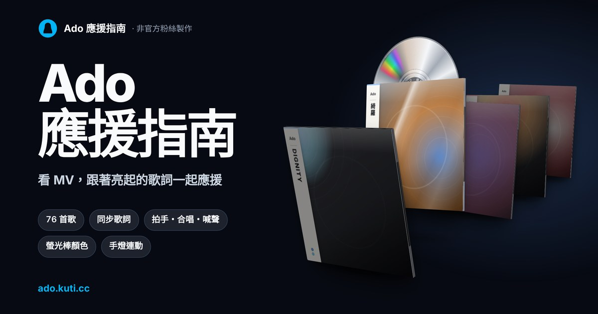

# Ado 應援指南

[](https://gcree.github.io/ado-guide/)

非官方粉絲製作的 Ado 演唱會應援指南網站。看著官方 MV，跟著歌詞知道哪裡拍手、哪裡喊、哪裡跟著唱、哪裡安靜聽。不照任何一場的歌單，不會暴雷。

**👉 打開網站：<https://ado.kuti.cc/>**

- **76 首歌**：原創曲和翻唱曲都有，每首有自己的網址，可以直接分享。
- **同步歌詞**：日文（含假名）和繁體中文翻譯，唱到哪一句亮哪一句；觀眾要唱的字、喊的聲另外標色。
- **現在要做的事**：歌詞依動作上色，大字提醒字卡跟著拍子提示拍手、合唱、喊聲；電腦版影片下方另有提示框。
- **螢光棒顏色**：每首歌的代表色，畫面燈光也跟著變。
- **練習工具**：打開歌曲自動播放、0.5／0.75 倍速、拍點聲、連動手燈（搭配 PenlightSync）、只看大合唱、播完自動下一首、分享目前時間。
- 手機直拿、橫拿和電腦都能用。

應援寫錯或時間不準，可以在網站頁尾按「意見回饋」，或在歌曲頁的「練習工具」→「回報錯誤」告訴我們。

### 連動手燈（PenlightSync）

電腦版支援與 [PenlightSync](https://github.com/Gcree/penlight-sync)（v1.7.0 起）桌面 App 連動，透過藍牙即時控制 Ado 官方手燈。

1. 在首頁點擊「下載手燈連動」按鈕（會依作業系統自動下載 Windows 或 macOS 最新版；亦可從按鈕下拉選單選取），開啟 PenlightSync 後，在「色彩」頁將「取色來源」選為「網站（Ado 應援指南）」，並按「開始連動」連上手燈。
2. 在網站歌曲頁右上角的「練習工具」選單中，點擊「連動手燈」。
3. 連上後手燈會跟著歌曲代表色每小節變換，並在副歌高潮自動閃爍。

> **瀏覽器說明**：請使用 Chrome 或 Edge。若在 Chrome 從線上網站連線時被阻擋，可在 `chrome://flags/#local-network-access-check` 關閉檢查，或直接以本機網址（`http://localhost:8000`）開啟網站。Safari 因安全限制無法從 HTTPS 網頁連線本機 WebSocket，請使用 Chrome 或 Edge。

以下是給維護網站的人看的說明。

## 1. 專案結構

平常只改下面前五個檔案，用 http(s) 開啟就能用；發布時 GitHub Actions 會另外建出每首歌的獨立頁，並把歌詞拆成每首一個小檔（打開哪首才下載哪首）。

```text
index.html                  ← 網站的版面（HTML）
style.css                   ← 樣式：顏色、排版、手機版
app.js                      ← 所有互動程式（播放、歌詞捲動、搜尋、燈光效果）
songs.js                    ← 歌曲資料表（歌單 SONGS、歌ネット編號 UT、螢光棒 PEN、拍點 BEAT、副歌高潮 CLIMAX）
song-lyrics.js              ← 每首歌的同步日文歌詞、繁中翻譯與逐行應援動作
CHANGELOG.md                ← 更新日誌；網站頁尾的「更新日誌」直接讀這個檔案
manifest.webmanifest        ← 加到手機主畫面時的名稱、圖示與顏色
assets/                     ← 網站圖示（favicon、主畫面圖示）與分享預覽圖 og.jpg
scripts/check-data.mjs      ← 資料自動檢查：檢查歌曲與歌詞一致性、動作合法性、時間順序等
scripts/build.mjs           ← 建置：每首歌一頁 song/<id>/、歌詞拆檔 lyrics/<id>.json、sitemap.xml、404.html，輸出到 dist/
.github/workflows/pages.yml ← 推到 main 就建置並發布到 GitHub Pages
README.md                   ← 這份說明
google….html               ← Google Search Console 的擁有權驗證檔，不要刪
開啟網站.command             ← 在自己的 Mac 上看網站時點兩下（開一個本機伺服器）
```

資料表說明：

| 檔案 | 名稱 | 內容 |
| --- | --- | --- |
| `app.js` | `ACT` | 應援動作的名稱、圖示與說明（大合唱、拍手、揮手、跳躍、喊聲、手勢、安靜聽） |
| `app.js` | `PENC` | 螢光棒顏色的色碼與中文名稱 |
| `app.js` | `REPORT` | 回報表單：Google 表單「Ado 應援指南｜回報與意見回饋」的網址與各題的 entry 編號；改表單題目後要重新對編號，留空時改成複製文字 |
| `songs.js` | `SONGS` | 歌單：歌名、MV、長度、整首應援重點；`hold: true` 表示應援和螢光棒顏色還沒確認，資料留著但畫面不顯示；`sug: true`（翻唱曲依曲風寫的建議）也一樣先不顯示 |
| `songs.js` | `UT` | 每首歌在 Uta-Net 的歌詞頁編號（「正版歌詞」連結） |
| `songs.js` | `PEN` | 每首歌的螢光棒顏色；開頭 `?` 是原文的預測，先不顯示，畫面當作沒指定 |
| `songs.js` | `BEAT` | 每首歌的 BPM、第一個小節的時間與拍點是否可靠（燈光與拍點聲用） |
| `songs.js` | `CLIMAX` | 副歌高潮噴彩帶的時間 |

`song-lyrics.js` 是唯一要改的歌詞檔，`lyrics/` 由建置自動產生，不用手動改。每一行是 `{ time, jp, tr, acts, sing, call }`：`time` 是 MV 秒數，`acts` 是這行的動作，`sing` 是觀眾要唱的字，`call` 是喊聲。

## 2. 在自己電腦上看

直接點開 `index.html` 時 YouTube 不允許嵌入播放，MV 不會播。請點兩下 `開啟網站.command`，或在資料夾裡開一個靜態伺服器：

```bash
python3 -m http.server 8000
```

再打開 <http://localhost:8000/>。

想看發布後的樣子（含每首歌的獨立頁）：

```bash
node scripts/build.mjs dist
```

再到 `dist` 資料夾開靜態伺服器。獨立頁的網址、分享圖與 canonical 都寫成正式網址，所以本機只用來看版面和功能。

直接開原始檔時沒有拆好的歌詞，網頁會自動改讀整份 `song-lyrics.js`；建置後的網頁（`<html data-lyrics="…">`）才會一首一首讀 `lyrics/`。

### 資料自動檢查

改完歌曲或歌詞資料後，可以先跑資料檢查腳本，確認格式、動作名稱、時間順序與資料表完整性（GitHub Actions 發布前也會自動跑）：

```bash
node scripts/check-data.mjs
```

## 3. 發布到 GitHub Pages

儲存庫是公開的，**Settings** → **Pages** 的 Source 設為 **GitHub Actions**。推到 `main` 後 `.github/workflows/pages.yml` 會跑 `node scripts/build.mjs dist` 並發布 `dist/`，一兩分鐘後 <https://gcree.github.io/ado-guide/> 就會更新；進度在 GitHub 的 **Actions** 分頁。

## 4. 搜尋引擎（SEO）

- **每首歌一頁**：`song/<id>/` 有自己的標題、說明、canonical 與結構化資料（schema.org 的 WebPage／MusicRecording），打開會直接進那首歌。網站內切歌仍用 `#<id>`，搜尋引擎收錄的是獨立頁。
- **網站地圖**：`sitemap.xml` 列出首頁和所有歌曲頁，已提交到 Google Search Console。新增歌曲後不用另外提交，Google 會再讀。
- **Google Search Console**：帳號 kuti36.work，建議在 GSC 新增「網址前置字元」`https://ado.kuti.cc/`（首頁 HTML 標記與根目錄的 `googlea6b361c7e6e7d11c.html` 驗證檔均已具備，可秒通過驗證），並提交 `https://ado.kuti.cc/sitemap.xml`。
- **網站爬蟲（robots.txt）**：現已綁定自訂獨立網域，`robots.txt` 位於網域根目錄 `https://ado.kuti.cc/robots.txt`，能被所有搜尋引擎與 AI 爬蟲完整讀取。

## 5. 改版流程

1. 改 `index.html`、`style.css`、`app.js`、`songs.js` 或 `song-lyrics.js`。
2. 跑 `node scripts/check-data.mjs` 確認資料沒有格式或邏輯錯誤。
3. 不用改快取版本字串：原始檔寫 `?v=dev`，建置時會依內容自動換成新的，手機不會讀到舊檔。
4. 在 `CHANGELOG.md` 最上面加一段新版本（標題寫 `## vX.Y.Z — 日期`）；建置時頁尾版本號會自動換成這一版，不用手改 `index.html`。
5. 新增歌曲時，`songs.js` 的 `SONGS` 加一筆、`song-lyrics.js` 加歌詞，就會自動多一個獨立頁、歌詞檔，並列進網站地圖。
6. commit 並推到 `main`，GitHub Actions 會自動檢查並發布。

## 6. 資料來源與致謝

- 原創曲的應援動作：[じゅん🌝ぴ 在 note 的整理](https://note.com/jun1217imokenp/n/nda2715681fcd)（2024 年 4 月）。翻唱曲原文沒寫；依曲風寫的建議和原文只是預測的螢光棒顏色先不顯示。
- 網站架構與歌詞檔格式參考 [Vaundy 台北場應援指南](https://vaundy.tiaui.co/)（[GitHub](https://github.com/watain666/Vaundy-Taiwan-2026)），它 fork 自 [SEOUL 응원가이드](https://vaundy-seoul-2026.pages.dev/)。
- MV：Ado 官方 YouTube 頻道。
- 正版歌詞連結：[Uta-Net](https://www.uta-net.com/artist/29298/)。

實際應援以現場氣氛和 Ado 的引導為準。MV、歌詞與圖像的著作權屬於原權利人。
