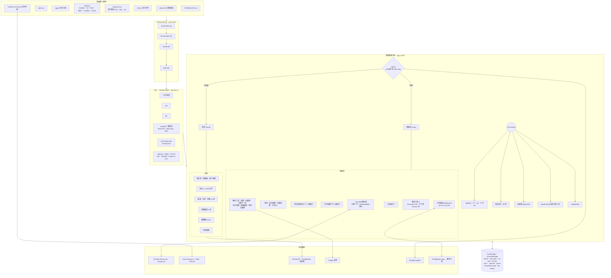
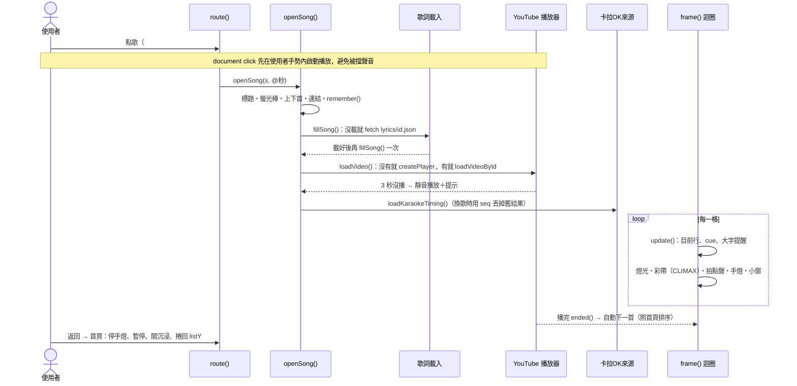
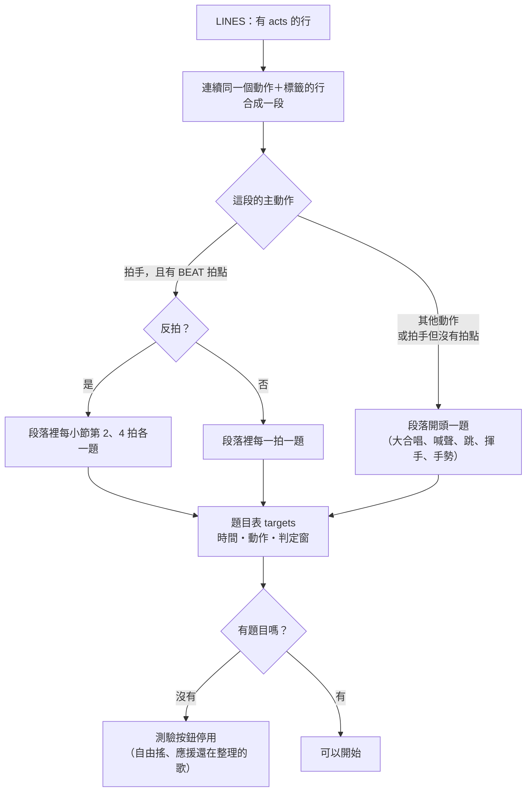
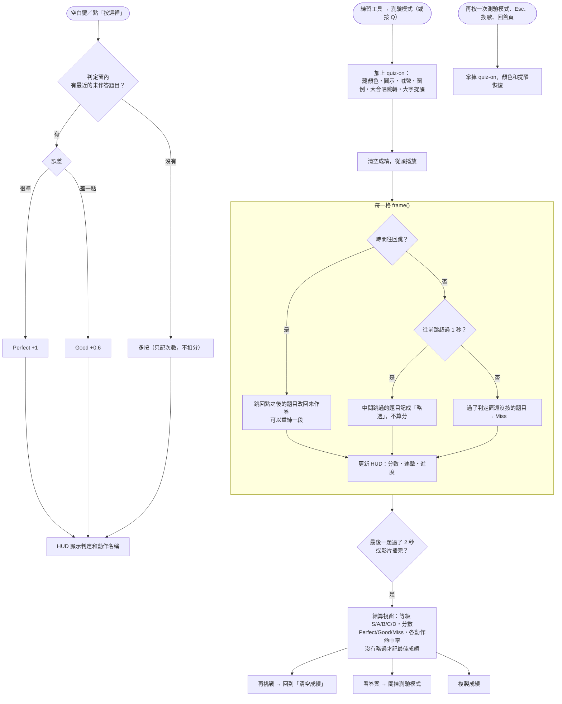

# 網站架構

## 1. 檔案、建置與執行期

## 2. 打開一首歌的流程

## 3. 測驗模式（拍點挑戰）

藏起歌詞顏色、動作圖示、喊聲標籤和大字提醒，使用者在該應援的地方按空白鍵或點「按這裡」，依時間準不準給分。

### 3-1. 題目怎麼來

### 3-2. 操作流程

- 判定窗以真實時間算（影片時間 ÷ 播放速度），放慢練習時一樣公平。拍手題 Perfect ±0.08 秒、Good ±0.16 秒；段落開頭題比較難抓，放寬成 ±0.15／±0.35 秒。
- 測驗中空白鍵拿來作答，播放／暫停改用 K 或點影片；不會自動跳下一首。
- 最佳成績存在這台裝置（`quiz-best`），記分數和當時的播放速度。
