# 新歌工作站（Ado Studio）規劃

> 狀態：M0（本機伺服器、存檔、同步、發布）、M1（貼網址匯入、官方字幕、兩個平台的安裝）、M2（拍點、BPM、段落、副歌高潮）、M3（分離人聲、自動對時、翻譯）、M4（新介面）已完成；M5（應援預測）規劃中。目標是新增歌曲的時候不用每次都透過 Claude：音檔、BPM、拍點、字幕初稿都由工作站自動算好，人只負責「確認和微調」，存檔後就能直接發布。Claude 改成只做「上網找資料、整理別人提供的應援」，產出一份情報包讓工作站匯入。

## 0. 我的看法

方向是對的，而且現在的程式碼已經幫我們鋪好一半的路：

- `tools/timing/` 已經有完整的打點、時間軸、應援標籤、歌曲資料編輯，`lyrics-store.js`、`song-meta-store.js` 也已經是「只改這首歌那幾行」的安全寫入邏輯，而且是 UMD，node 可以直接拿來用。
- `songs.js` 已經有「預測」的位置：`hold`（整理中不顯示）、`sug`（暫定建議）、PEN 開頭 `?`（預測色不顯示）。工作站產生的預測只要照這套規則寫，網站就不會把猜的東西當真的顯示出來。
- `karaoke-sources.js` 已經會去 LRCLIB、QQ、網易雲、AMLL 抓逐行／逐字時間，`scripts/align_live_offsets.py` 已經在用 yt-dlp + ffmpeg 算 MV 和 LIVE 的時間差。

缺的是兩塊：

1. **瀏覽器做不到的事**：下載 YouTube、跑音訊模型（分離人聲、抓拍點、對齊歌詞）。這要一個在自己電腦上跑的小伺服器。
2. **一個整合的介面**：把「匯入 → 分析 → 微調 → 檢查 → 發布」串成一條線，而不是現在散在 3 支腳本和 1 個工作台。

幾個要先講清楚的取捨：

| 議題 | 建議 |
| --- | --- |
| 伺服器用什麼寫 | **Node 管資料、Python 管音訊**。Node 伺服器負責讀寫 `songs.js`、`song-lyrics.js`（沿用現有 store）、跑檢查、git；音訊分析寫成幾支 Python 指令，伺服器呼叫它們、拿回 JSON。這樣寫檔的邏輯只有一份。 |
| 自動對時能多準 | 有人聲分離＋已知歌詞的強制對齊，一般句子誤差大約 0.1–0.3 秒，**Ado 的嘶吼、和聲、極快 rap 段會錯**。所以每句都帶「信心分數」，低分的句子在介面上標紅，人只要檢查這些。 |
| 應援和手燈色 | 新歌不可能自動「知道」，只能預測。預測一律存成 `sug`／`?` 狀態（網站不顯示或標「暫定」），等 Claude 找到現場資料或你確認後才轉正式。 |
| YouTube 下載 | 只在自己電腦上做分析用，音檔、分軌放在 `tools/studio/work/`（不進版控、不發布）。 |
| 發布 | 工作站的「發布」= 跑 `check-data` ＋ `test-karaoke` → 只 commit 歌曲資料檔 → 拉遠端最新 → **直接推 `main`**（約 2 分鐘上線）。 |
| 中文翻譯 | **官方有中文就用官方的**（MV 的 YouTube 字幕由頻道上傳的繁中軌）；沒有才呼叫 `agy` 翻譯。 |
| 平台 | **Windows 先用，之後搬到 Mac mini**：同一份程式，只有安裝腳本分兩版（見第 10 節）。 |

## 1. 整體架構

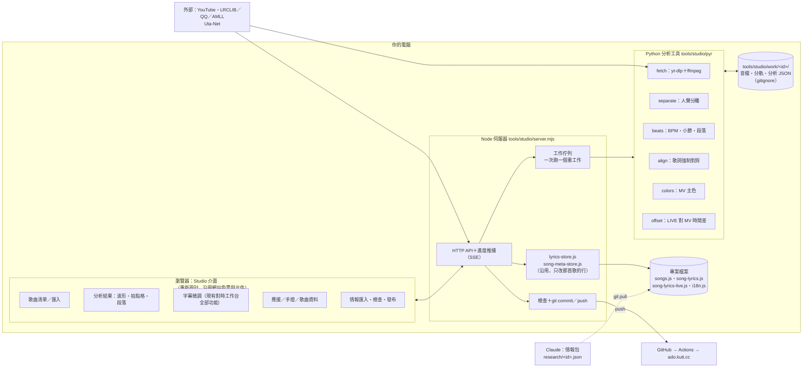

## 2. 新歌從匯入到上線（總流程）

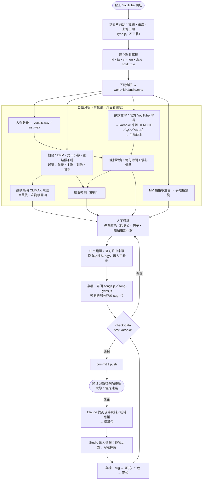

## 3. 音訊分析管線

每一步的輸出都存成 JSON 快取在 `work/<id>/`，重跑時已經有的就跳過（換了模型或參數才重算）。

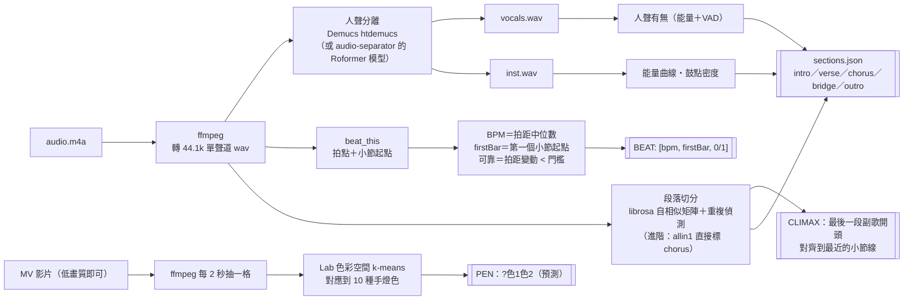

### M2 實際做法與準確度（2026-11-08）

- **拍點**：librosa 找拍，再用「相鄰兩拍各自四捨五入」累加拍數、套固定速度的格子（直接用總時間除會因為 23 毫秒的量化誤差，上百拍後整個套歪）。套得好不好（落在格子上的比例、平均誤差）決定可不可靠；起音偵測固定晚一格（23 毫秒），已扣掉。
- **兩倍／一半速度**：鼓的打法常常分不出來（〈シンカ〉195 vs 97.5 就是這種）。兩個都說得通時，選「小節第一拍最明顯」的那個速度，並一律列出備選讓人改選。
- **小節第一拍**：四種可能裡，看大鼓低頻＋和弦變化最常落在哪一拍；明顯勝出才把 BEAT 第三個值寫 1（網站用它標第一拍）。
- **副歌高潮**：歌詞（後半段裡跟前面重複最長的那句）＋音訊（後半段能量跳升、副歌段落開頭），3 秒內的候選合併計分。
- **量過的**：
  - 合成測試歌（128／96／150／195 BPM，已知答案）：BPM 全對（195 靠第一拍判斷選對）、第一小節差 3 毫秒內、最後一次副歌開頭全對；沒有鼓的抒情歌和雜訊會標「不穩」，不會假裝有把握。
  - 歌詞找副歌高潮，對現有 78 首的 CLIMAX：第一個候選對（差 1.5 秒內）47 首（60%），前三個候選裡有對的 60 首（77%）。
  - 真實音訊還沒量（雲端連不到 YouTube）：在你的電腦跑 `node tools/studio/cli.mjs bench --download`，會下載現有歌曲的音訊、拿人工調好的 BEAT／CLIMAX 對答案，結果貼給 Claude 調參數。
- **用法**：匯入新歌時自動分析並填 BEAT／CLIMAX；已有的歌在對時工作台「🎨 歌曲資料」→「分析音訊」，或 `analyze <id>`（`--apply` 寫入，已有人工值要 `--overwrite`）。

## 4. 字幕自動對時與翻譯

官方字幕最可靠：Ado 的 MV 常有頻道自己上傳的日文、繁中字幕，日文字幕本身就帶每句時間。所以照下面的順序取，取不到才往下：

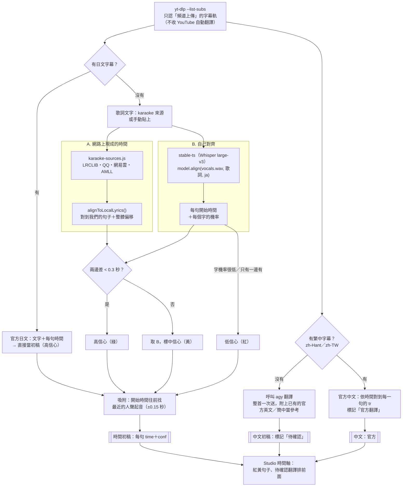

> 小提醒：信心分數 `conf` 和「官方／待確認」標記只存在 `work/`，不寫進 `song-lyrics.js`，網站資料格式不用改。

### agy 怎麼接

`agy`（Antigravity CLI）有官方的「不開視窗」模式：`agy -p "<提示>" --output-format json`，跑完就結束、把結果印出來（要先用一般模式登入過一次）。但有兩個坑：

- 有人回報：**不是在真的終端機裡跑時（被別的程式呼叫，正是工作站的情況），`-p` 的輸出會不見**。
- 歌詞很長、有引號和日文，直接放進命令列，在 Windows 的 `cmd.exe` 很容易被拆壞。

所以 `tools/studio/agent-cli.mjs` 這樣接：

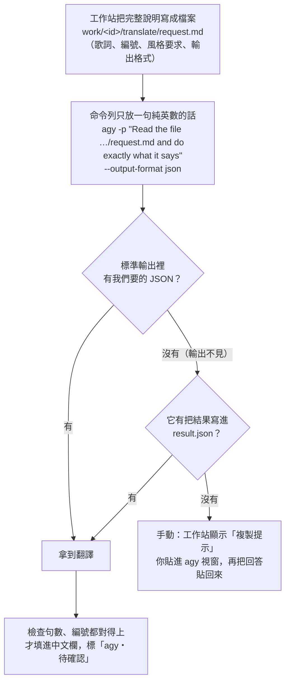

- 解析很寬鬆：外面包一層 JSON 信封、有 ```json 圍欄、一行一個 JSON（stream-json）都挖得出來。
- 同一套也能接 `gemini -p`、`claude -p`，換工具只改 `tools/studio/config.json`（不進版控）。
- **先在你的 Windows 上試**：`node tools/studio/agent-cli.mjs --probe`。它會拿〈踊〉已經有翻譯的 4 句，請每個裝了的工具翻一次，印出「現有翻譯 vs 工具翻譯」對照、哪種方式拿得到結果（標準輸出或檔案），並把能用的寫進 `config.json`。每次的完整紀錄在 `tools/studio/work/_probe/<工具>/cli.log`。

翻譯的要求（給 agy 的提示）固定在 `tools/studio/prompts/translate.md`，內容會照網站現有翻譯的風格：台灣用語、短句、保留歌詞換行、專有名詞不翻。

### M3 實際做法與準確度（2026-11-08）

- **分離人聲**：Demucs `htdemucs`（`py/separate.py`），存 `work/<id>/vocals.wav`。有 NVIDIA 用 CUDA、Apple 晶片用 MPS，否則 CPU（60 秒的音訊 CPU 約 24 秒）。
- **自動對時**：stable-ts 的 `align`（`py/align.py`）：把已知的日文歌詞對到人聲上，一行一段；每句信心＝字的機率平均（≥0.5 高、≥0.3 中、其他低，初步門檻）。漢字後的讀音標注（模(かたど)る）對齊時拿掉、檔案裡保留；和聲括號照樣要唱。沒對上的句子夾在前後句之間平均排。模型：有顯卡 `large-v3`，沒有 `medium`（`config.json` 的 `whisperModel` 可改）。
- **沒有時間的歌詞**：`lyrics-import` 收「日文<Tab>中文」（不寫時間），先平均排開；加 `--align` 馬上對時，並依結果重新補（間奏）（尾奏）。
- **翻譯**：只翻沒有中文的句子（`--all` 全部重翻）；說明檔 `prompts/translate.md` 附整首上下文、官方英文字幕（有的話）和網站現有翻譯當風格範例；寫入後記在 `work/<id>/translate.json`（之後介面標「agy 翻譯・待確認」）。
- **量過的**（雲端沒有真的歌聲：用語音合成念〈シンカ〉8 句、疊在合成音樂上，已知每句開始時間）：Whisper `base` 在分離後的人聲上 8 句全對上，平均差 0.07 秒、最多 0.17 秒；直接用混音平均 0.13、最多 0.29 秒（分離有幫助）。真的歌聲（嘶吼、和聲、長音）會比較難，你的顯卡會用 `large-v3`。
- **對時工作台**：「＋ 工具」選單：匯入新歌、自動對時這首、翻譯缺的中文；本機有沒存的打點進度會先提醒，完成後重新載入。

## 5. 應援預測規則（初版）

全部都只是「建議」，寫入時一律是 `sug: true`，逐行動作也只填在 Studio 裡讓你確認。

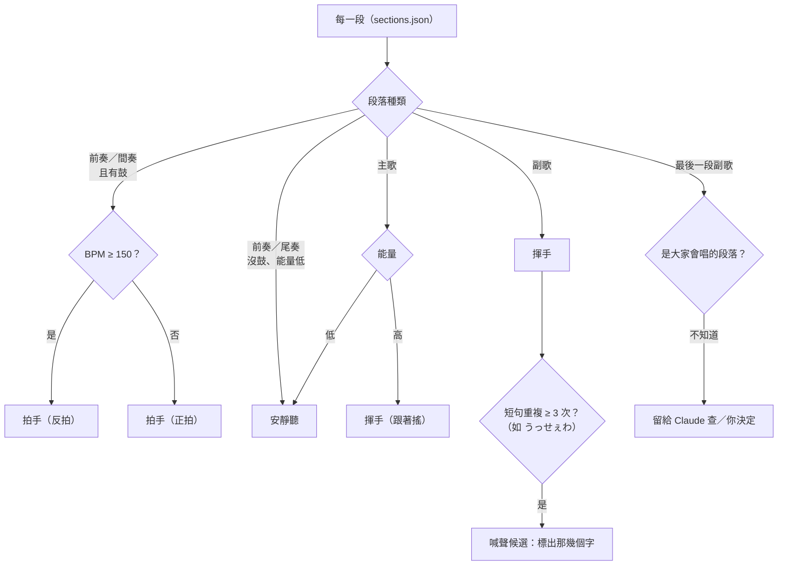

## 6. 你、工作站、Claude 的分工

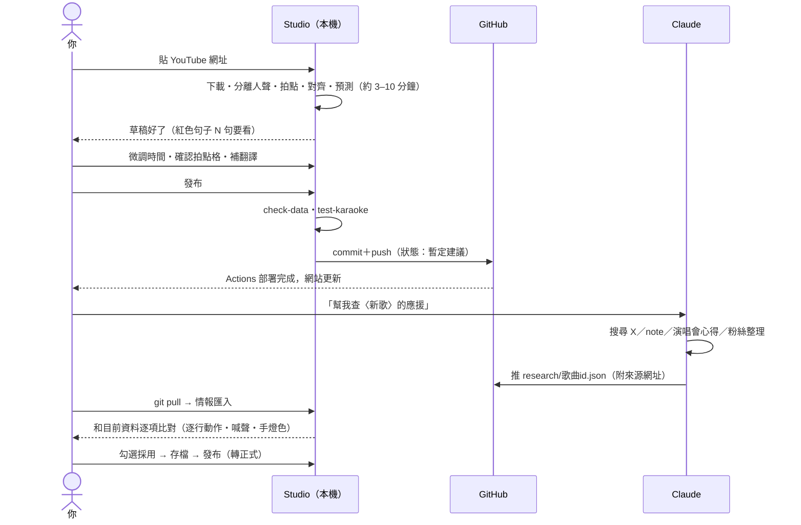

### 情報包格式（Claude 產出，`research/<id>.json`）

讓 Claude 交出來的東西有固定格式，Studio 才能逐項比對、勾選：

```json
{
  "id": "andjuly",
  "updated": "2026-11-07",
  "sources": [
    { "url": "https://…", "who": "整理者名稱", "kind": "note|x|blog|video", "date": "2026-11-01" }
  ],
  "pen": { "colors": ["青", "白"], "src": [0], "sure": true },
  "status": "",
  "tips": ["副歌舉手跟著搖"],
  "lines": [
    { "jp": "歌詞原文（用來對到我們的句子）", "acts": ["call"], "call": "Hey!", "src": [0], "sure": false }
  ],
  "notes": "其他沒辦法結構化的資訊"
}
```

每一項都附 `src`（指向 sources）和 `sure`（是否有多個來源互相印證），之後也可以直接拿來更新 `ADO_SONGS_CREDITS.md`。

## 7. 資料狀態

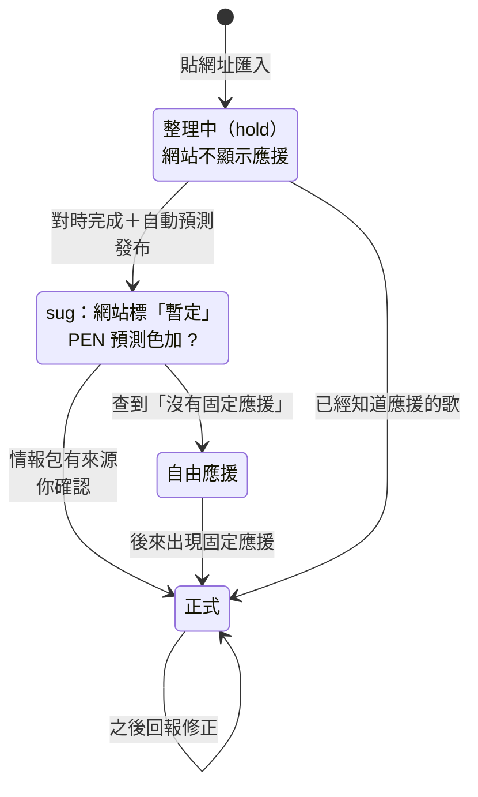

## 8. Studio 介面：Notion 風格

不沿用對時工作台，另外做一套。設計稿在 `tools/studio/ui/`（用工作站開 <http://localhost:5178/tools/studio/ui/>），用〈シンカ〉的真實歌詞、BPM、副歌高潮，加上假的波形、段落、信心分數。

**概念**：像在 Notion 裡整理一首歌，**每首歌就是一頁**。

| 元素 | 規則 |
| --- | --- |
| 底色 | 暖白底、側欄淺灰；深色版是 Notion 的深灰。分隔只用很淡的細線 |
| 按鈕 | 平常沒有框，滑過才出現淡灰底；只有「發布」是藍色實心 |
| 標籤 | Notion 的九種柔和標籤色（灰、棕、橘、黃、綠、藍、紫、粉、紅），用在狀態、段落、應援、信心 |
| 強調 | 藍：選取、播放指針、已播過的波形 |
| 信心 | 綠＝高、黃＝中、紅＝要檢查（歌詞塊左邊的色條；低信心整塊淡紅底） |
| 應援色 | 大合唱藍、喊聲粉、拍手橘、揮手黃、跳躍綠、手勢紫、安靜聽灰 |
| 預測 | 一律是虛線框或斜線，確認後才變實心 |
| 字 | 系統黑體（Windows：Segoe UI＋微軟正黑體，Mac：蘋方）；時間碼用等寬字 |
| 主題 | 淺色為主，也有深色，跟著系統，右上角可切換 |

**版面**：像剪輯軟體。**中間只放編輯，補充資訊都在右邊。**

- **左側欄**：搜尋、情報收件匣（有新的情報包會顯示數字）、貼網址匯入；下面像頁面樹，歌曲依「處理中／整理中／暫定建議／正式」分組，處理中的顯示進度圈和紅色句數。
- **頂部**：麵包屑（歌曲 / 處理中 / シンカ）、檢查燈號、深淺色、同步、發布。
- **中間（編輯區，不捲動）**：
  - **預覽**：依剩下的空間放到最大（16:9）。目前這句**當字幕浮在畫面下方**（日文＋中文，不會被迫換行；低信心的句子左邊有紅線），左上角標目前段落和應援（預測的加「預測」），右上角是時間碼。字幕可以用 C 開關。
  - **走帶列**：播放、時間碼、第幾小節、速度、循環這句、字幕開關、打點（Space）。
  - **兩個檢視分頁**＋「N 句要檢查」「下一個紅色 G」：
    - **時間軸**：尺規 → 段落 → 拍點 → **歌詞**（含中文和時間）→ **人聲波形** → 應援 → 全曲縮圖（段落、紅黃句子的位置、目前看的範圍，點一下跳過去）。
    - **歌詞表**：#、時間、日文、中文、應援、信心，一句一列，適合整首看過一遍。
  - 視窗變窄時，次要的字會收起來只留圖示。
- **右側檢查器**，三個分頁：
  - **句子**：選取那一句的「頁面」：標題是日文歌詞，屬性有開始時間（±0.05、±0.2 微調）、對齊信心、段落、中文來源（官方字幕／agy 翻譯・待確認）、應援（七種，可複選）；下面可直接編輯日文、中文、合唱詞、喊聲，還有前後句。
  - **歌曲**：歌名、狀態、長度、BPM、副歌高潮、手燈、作詞作曲、合作、發布日、MV、要檢查的句數、處理進度（每一步花多久）、應援重點。
  - **情報**：情報包的來源和建議變更，每一項列出「目前 → 情報」和來源數，可以逐項採用或略過，或全部採用。
- 現有快捷鍵全部保留（空白鍵打點、`[` `]` 微調、Enter 試聽、G 下一個紅色、1–7 應援動作…）。

### M4 實際做出來的（2026-11-08）

`tools/studio/ui/`（`index.html`、`studio.css`、`app.js`），工作站打開的首頁。資料都經過伺服器的 API，寫入規則跟命令列共用 `core.mjs`。

- **側欄**：搜尋、貼網址匯入（輸入 id 後匯入，完成自動打開）、依狀態分組的歌單；有要檢查的句子顯示數字、有沒存的草稿標「草稿」。
- **預覽**：YouTube 播放器（載不到時改用模擬時鐘，時間軸照樣能編）、字幕浮在畫面下方、左上段落和應援、右上時間碼。
- **時間軸**：段落（分析結果）、拍點格（BEAT）、歌詞塊（信心顏色；拖曳改時間，會吸附拍點、按住 Alt 不吸；Shift／Ctrl 多選一起拖）、人聲波形、應援、全曲縮圖；滾輪捲動、Ctrl＋滾輪縮放、點空白處跳轉、播放時跟著走。
- **歌詞表**：一句一列，看整首。
- **句子**：開始時間（±0.05／±0.2、直接輸入、設為目前時間）、信心、段落、中文來源、應援、日文、中文、合唱詞、喊聲、動作說明、下面加一句、刪除；多選時整段平移、一起改應援。
- **歌曲**：狀態、手燈（依順序、可標預測）、應援動作、應援重點（含英日翻譯）、副歌高潮、LIVE 映像，按「存歌曲資料」寫回；分析音訊（改選速度、點選高潮候選、寫入 BEAT）；自動對時、翻譯缺的中文、貼上歌詞（可以不寫時間、可以匯入後馬上對時、應援依日文對回同一句）。
- **情報**：讀 `research/<id>.json`，逐項顯示「目前 → 情報」和來源；手燈、狀態、應援重點按「採用」直接寫，逐句應援改在草稿上（記得存檔）；可以略過、全部採用。
- **草稿與存檔**：每次修改自動存在這台電腦，重新整理或換歌都不會不見（回來時可以還原或丟掉）；可以復原／重做；存檔前檢查時間順序；檔案被別人改過時擋下來。
- **檢查、同步、發布**：同 M0。

**還在舊版對時工作台的**：現場版（LIVE）對時、從 MV 版複製到現場版、把一句拆成兩句、整段選到最後、下一句沒打點的（G 改成跳到下一個要檢查的）。

## 9. 建議用的套件

| 用途 | 套件 | 備註 |
| --- | --- | --- |
| 下載 | `yt-dlp`、`ffmpeg` | 已經在用 |
| Python 環境 | `uv` | 一行裝好、Windows／Mac 都一樣，不用自己管 venv |
| 人聲分離 | `demucs`（htdemucs） | 穩定；想要更乾淨的人聲可以換 `audio-separator` 的 BS-Roformer 模型 |
| 拍點＋小節 | `librosa`＋固定速度格子（M2 用這個） | 輕、不用顯卡；bench 結果不夠好的話，M3 裝 PyTorch 時再加 `beat_this`（CPJKU, 2024） |
| 段落 | `librosa`（自相似＋重複） | 進階可試 `allin1`（直接標 verse／chorus），但它在 Windows 上很難裝，列為選配 |
| 歌詞對齊 | `stable-ts`（Whisper large-v3） | `model.align()` 是「已知歌詞對時間」，比單純辨識準；沒有 GPU 時一首約數分鐘 |
| 網路時間 | 現有 `karaoke-sources.js` | 直接在 Node 端呼叫 |
| 主色 | `ffmpeg` 抽格＋`numpy` k-means | 不需要額外模型 |
| LIVE 時間差 | 現有 `align_live_offsets.py` | 改成吃參數、不寫死 ffmpeg 路徑，接進 Studio |
| 伺服器 | Node 內建 `http` | 不加框架，跟專案現在零依賴的風格一致 |

## 10. 兩個平台：先 Windows，之後 Mac mini

程式只有一份（Node 伺服器、Python 分析工具都跨平台），差別只在「怎麼裝」和「用哪種加速」：

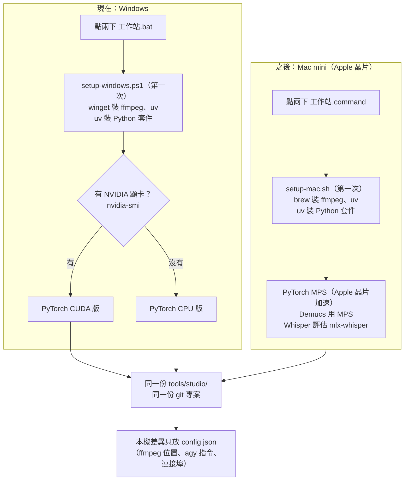

- **搬家**：歌曲資料都在 git 裡，Mac mini 上 `git clone` ＋ 點兩下 `工作站.command`（第一次會自動安裝）就好。`work/` 裡的音檔和分析快取不搬，需要時在新電腦重算（結果一樣）。
- **不寫死路徑**：現在的 `scripts/align_live_offsets.py` 把 ffmpeg 寫死成 Windows 的路徑，M2 會改成自動在 PATH 找（找不到再看 `config.json`）。
- **兩邊都測**：每個階段做完，安裝腳本和分析工具在兩個平台各跑一次。

## 11. 分階段做

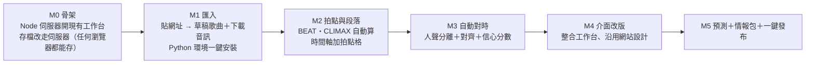

| 階段 | 做完你可以 | 主要檔案 |
| --- | --- | --- |
| M0 ✅ | 點兩下 `工作站.bat`／`工作站.command` 開工作台，任何瀏覽器都能直接存檔；「⟳ 同步」拉 Claude 推的情報包，「🚀 發布」檢查後推上 main | `tools/studio/server.mjs` |
| M1 ✅ | 貼網址就多一首整理中的歌，不用手改 `songs.js`；官方字幕自動帶入；兩個平台的安裝腳本 | `core.mjs` 的 `fetchSong`（yt-dlp）、`song-meta-store.js` 的 `addSong`、`setup/setup-windows.ps1`、`setup/setup-mac.sh` |
| M2 ✅ | 新歌的 BPM、拍點、副歌高潮不用再請 Claude 算 | `py/analyze.py`、`core.mjs` 的 `analyze`／`bench` |
| M3 ✅ | 字幕初稿自動出來，只修紅色句子；沒有官方中文時用 agy 翻 | `py/separate.py`、`py/align.py`、`prompts/translate.md` |
| M4 ✅ | 一個介面做完 MV 版的全部流程（現場版暫時還在舊的 `tools/timing/`） | `tools/studio/ui/` |
| M5 | 匯入 Claude 的情報、勾選採用、按一下就上線 | `research/`、`py/colors.py` |

M0–M2 不需要 GPU、裝起來也輕，建議先做；M3 的模型比較大（Whisper large-v3 約 3 GB），可以等前面順了再加。

## 12. Claude 也能操作：同一套核心、兩個入口

工作站是你我共用的。原則：**介面上的每個按鈕都對應一個命令列指令，兩邊呼叫同一份 `tools/studio/core.mjs`**，所以不管誰操作，檢查和寫入規則都一樣，也不會出現「介面能做、指令做不到」的事。

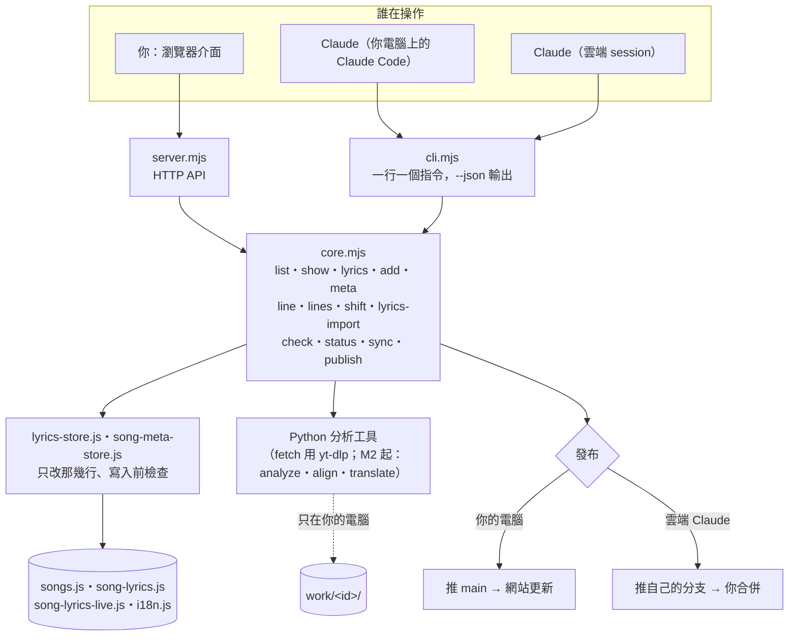

**給 Claude 的設計**（`CLAUDE.md` 會告訴之後每個 session 怎麼用）：

- 每個指令都能加 `--json` 拿結構化結果，失敗時 exit code 1、回 `{"ok":false,"error":"…"}`；錯誤訊息直接說哪裡不對、可以填什麼。
- 每個改資料的指令都能加 `--dry-run`：先看變更摘要，確認了再寫。
- 句子用編號（從 1）指定，`lines` 一次吃一份 JSON 改很多句，不用一句一句跑。
- 介面開著時 Claude 用指令改了檔案，介面存檔前會發現檔案被改過而擋下來，不會互相蓋掉。
- 雲端 session 不能下載 YouTube、沒有顯卡：查資料、整理情報包、改歌曲資料和歌詞、跑檢查都能做；分析類的指令要在你的電腦上跑。

**按鈕 ↔ 指令對照**（✅ 已經有；其他跟著各階段一起做）：

| 介面 | 指令 | 階段 |
| --- | --- | --- |
| 歌曲清單 | `list`、`show <id>` | ✅ |
| 歌詞列表 | `lyrics <id>` | ✅ |
| 貼網址匯入 | `fetch <網址> --id …`（自動填）；不能連 YouTube 時用 `add --id … --yt … --ja … --len …` 手動填 | ✅ |
| 歌曲資料面板 | `meta <id> --status … --acts … --tips … --pen … --climax … --beat …` | ✅ |
| 時間軸改一句、拖曳 | `line <id> <N> --time … --tr … --acts …` | ✅ |
| 多選一起改、整段平移 | `lines <id> --file …`、`shift <id> --by …` | ✅ |
| 貼上歌詞 | `lyrics-import <id> --file …` | ✅ |
| 檢查燈號、同步、發布 | `check`、`status`、`sync`、`publish -m …` | ✅ |
| 處理流程：拍點與段落 | `analyze <id> [--apply] [--bpm …]`、`bench`（對答案） | ✅ |
| 處理流程：分離人聲、字幕對齊 | `separate <id>`、`align <id> [--apply]`、`lyrics-import … --align` | ✅ |
| 翻譯 | `translate <id> [--apply]`（官方字幕優先，沒有才 agy） | ✅ |
| 情報分頁：逐項採用 | `research <id>`（列出差異）、`research <id> --apply 1,3,5` | M5 |

## 13. 已決定的事（2026-11-08）

1. **平台**：Windows 先用，之後搬到 Mac mini（Apple 晶片），安裝腳本做兩版。
2. **發布**：直接推 `main`。
3. **翻譯**：官方有中文就用官方的；沒有才呼叫 `agy`（接法見第 4 節）。
4. **情報包**：`research/<id>.json` 進版控（建置不會把它放上網站）。
5. **顯卡**：Windows 那台有 NVIDIA → 安裝腳本裝 PyTorch CUDA 版，人聲分離和 Whisper 對齊都用顯卡（預估一首一兩分鐘，實際看顯卡）。
6. **介面**：另做一套 Notion 風格的新設計（第 8 節），不沿用對時工作台；像剪輯軟體，中間只放編輯、字幕浮在預覽下方、補充資訊放右側；時間軸歌詞在上、人聲在下。
7. **你我共用**：每個功能都要有命令列指令，Claude 也能直接操作（第 12 節）。

還要確認：

- 在 Windows 上跑 `node tools/studio/agent-cli.mjs --probe`，看 `agy` 是從標準輸出還是檔案拿到結果，或兩個都拿不到。
- 新介面的設計稿看過之後的意見。
